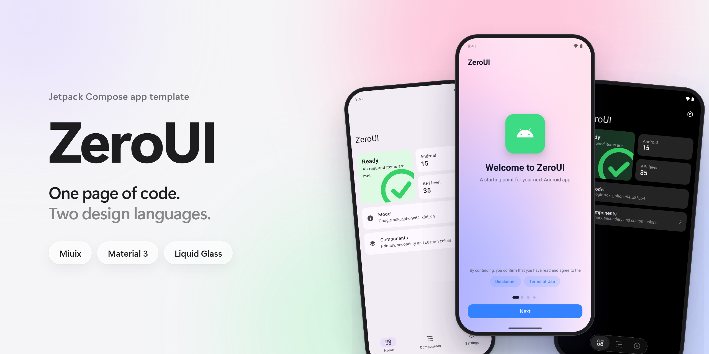
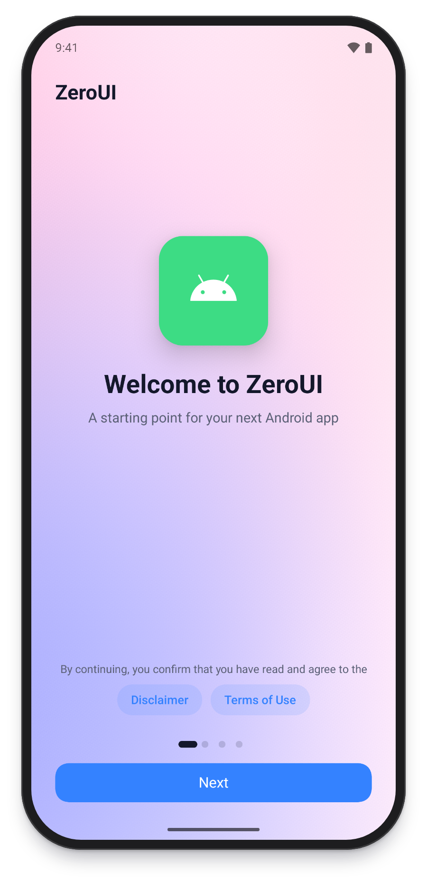
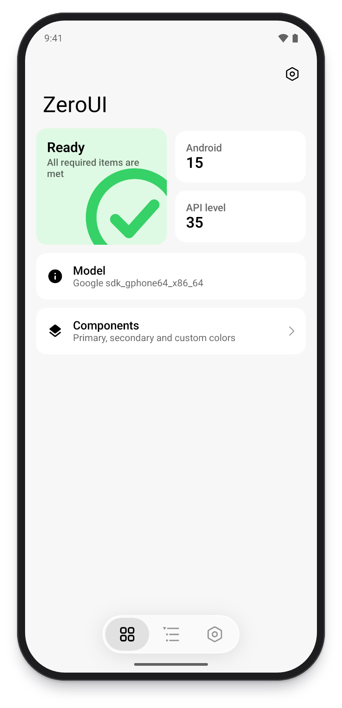
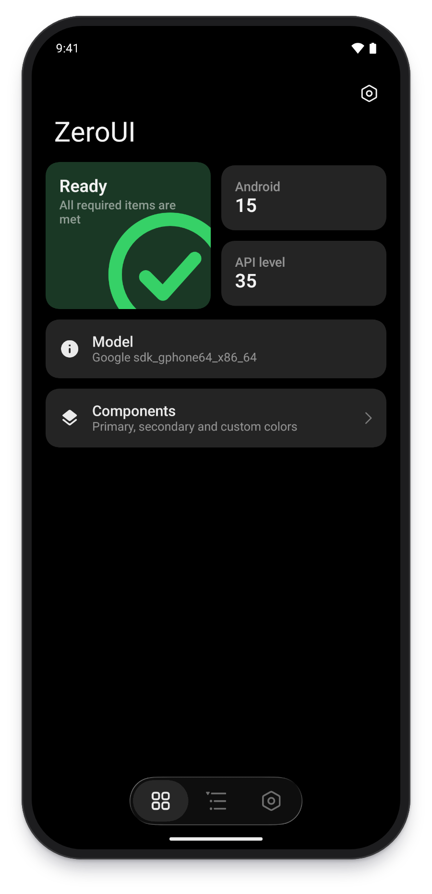
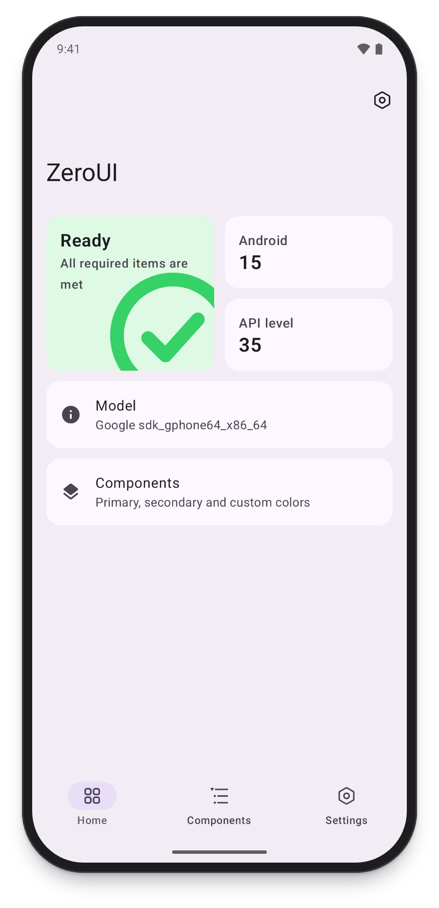
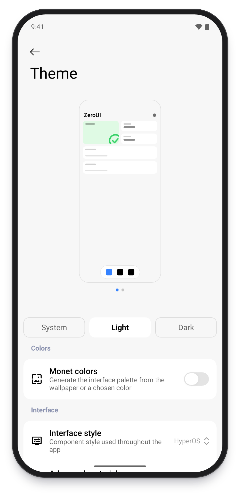
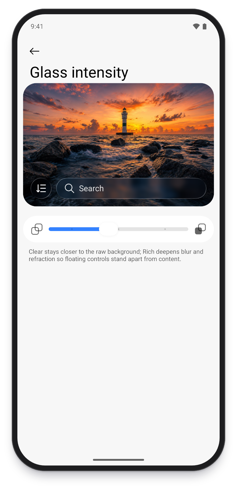
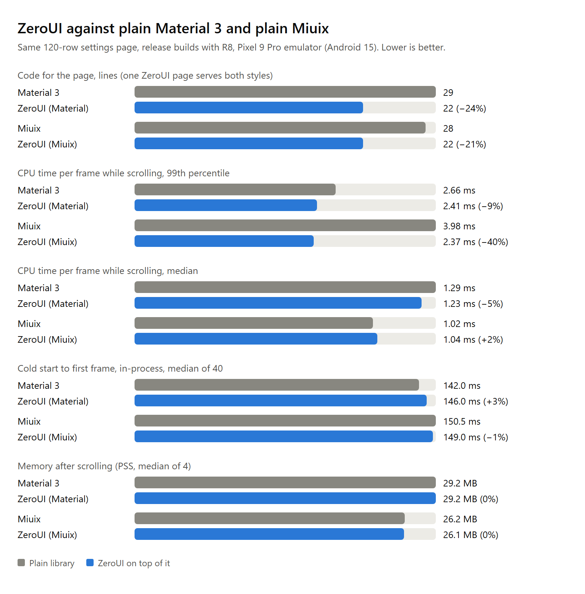
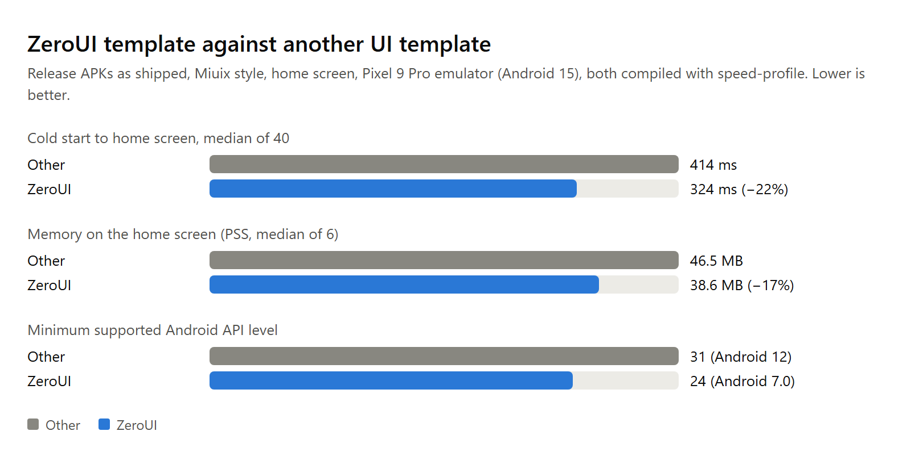

# ZeroUI

English | [简体中文](README.zh-CN.md)

ZeroUI is a Jetpack Compose app template. Pages are written once and can switch between a Miuix look and a Material 3 look.

## Screenshots

<p align="center">
  
  
  
</p>
<p align="center"><sub>Welcome · Miuix with a Liquid Glass bar · Dark</sub></p>

<p align="center">
  
  
  
</p>
<p align="center"><sub>Material 3 · Theme settings · Glass intensity</sub></p>

## What is inside

- `:kit`: the reusable design system. Theme, components, navigation, motion and Liquid Glass.
- `:app`: the template app. Welcome flow, home, component gallery, feature settings, app settings, theme settings and an about page.
- `:baselineprofile`: generates the Baseline Profile and measures cold start and frame timing.

## Features

- Home: status card, drag-to-reorder cards, pull to refresh, app settings from the top right.
- Theme: light and dark, dynamic color, custom seed color, pure black.
- Interface: icon style, UI scale, list density, smooth corners, top bar style, dialog position, page background image.
- Navigation: docked, floating or Liquid Glass bottom bar, side rail on wide screens, tab order and visibility.
- Motion and gestures: reduced motion, page transitions, predictive back, haptics, refresh rate.
- Appearance sharing: export a share code, apply one, reset to defaults.
- Other: languages, crash logs, update check against GitHub Releases, hiding the launcher icon, open source license list.
- Pages are restored after rotation and process death.
- Languages: English, Simplified Chinese and Russian.

## Performance

The same 120-line settings page, written once against the plain libraries and once with ZeroUI, release builds, measured on a Pixel 9 Pro emulator (Android 15). ZeroUI serves both styles from one page and costs about the same at runtime as using a library directly.



The template app against the release build of another UI template of the same kind (labelled Other), both on a Miuix-style home page:



Shipping both styles makes the release APK about 0.2 MB larger than the same page on a single library. Fixing one style with `-Pzeroui.style` brings that back down. Emulator numbers are only good for relative comparison.

## Requirements

- JDK 21
- Android SDK 37
- Android 7.0 (API 24) and above. Some visual effects need Android 13.

## Common commands

```bash
./gradlew :app:assembleDebug
./gradlew testDebugUnitTest lintDebug
bash tools/ci.sh
```

`tools/ci.sh` runs every gate in order. CI runs the same script.

| Step | What runs |
| --- | --- |
| Unit tests and lint | `testDebugUnitTest`, `lintDebug`, `assembleDebug` |
| Token check | `node tools/check/tokens.cjs check` |
| Public API | `node tools/api/api.cjs check` |
| Size limit | `node tools/size/check.cjs`, limits in `tools/size/limits.json` |

When the public API or the token baseline changes on purpose, run `node tools/api/api.cjs dump` or `node tools/check/tokens.cjs update`.

## Fixing one style

```bash
./gradlew assembleRelease -Pzeroui.style=miuix
./gradlew assembleRelease -Pzeroui.style=material
```

Without the property both styles are kept and can be switched in theme settings.

## Measuring

`tools/size/dex-methods.cjs` counts the method references of an APK.

## Baseline Profile

The profile lives at `app/src/release/generated/baselineProfiles/baseline-prof.txt` and ships with release builds. After a larger change to the UI or the dependencies, connect an emulator on API 33 or above, or a rooted device, and regenerate it:

```bash
./gradlew :app:generateReleaseBaselineProfile
```

To compare cold start and frame timing with and without the profile (on an emulator, add `-Pandroid.testInstrumentationRunnerArguments.androidx.benchmark.suppressErrors=EMULATOR`):

```bash
./gradlew :baselineprofile:connectedBenchmarkReleaseAndroidTest
```

## Starting an app from the template

1. Change `rootProject.name` in `settings.gradle.kts`.
2. Change `namespace`, `applicationId` and the version in `app/build.gradle.kts`, and rename the `com.zeroui.template` package to match.
3. Replace `app_name`, `ic_logo` and `ic_launcher_*`.
4. Replace the agreement text of the welcome flow and implement your own `SetupChecks`.
5. Change `AppRepository` in `AppSettingsScreen.kt`.
6. Add feature settings under `feature/tools`, and add feature pages as described in the [architecture notes](docs/ARCHITECTURE.md).

## Projects using ZeroUI

- [CZero](https://github.com/Xocio/CZero)

## Credits

- [KernelSU](https://github.com/tiann/KernelSU): the UI architecture borrows heavily from its manager's dual Miuix and Material implementation.
- [Miuix](https://github.com/compose-miuix-ui/miuix): the Compose components behind the Miuix style.
- [Jetpack Compose](https://developer.android.com/compose) and [Material Design](https://m3.material.io/).

## Documentation

- [Architecture](docs/ARCHITECTURE.md)
- [Compatibility matrix](docs/compat-matrix.md)
- [License](LICENSE): Apache-2.0
- [Third-party notices](THIRD_PARTY_NOTICES.md)
