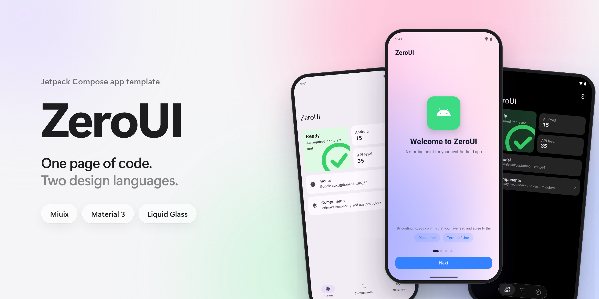
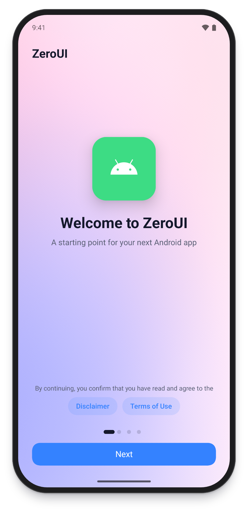
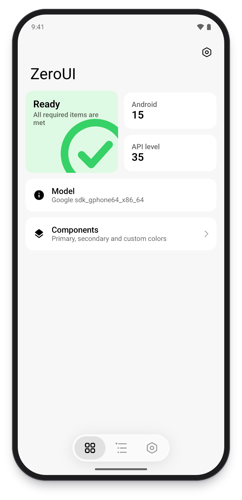
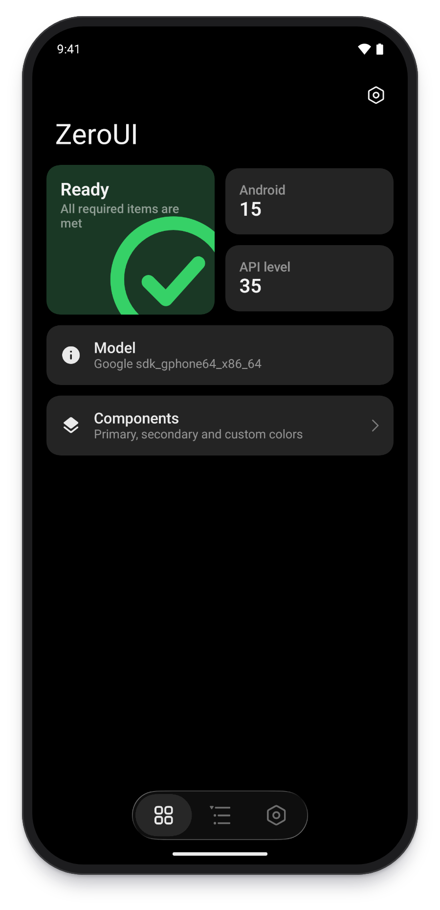
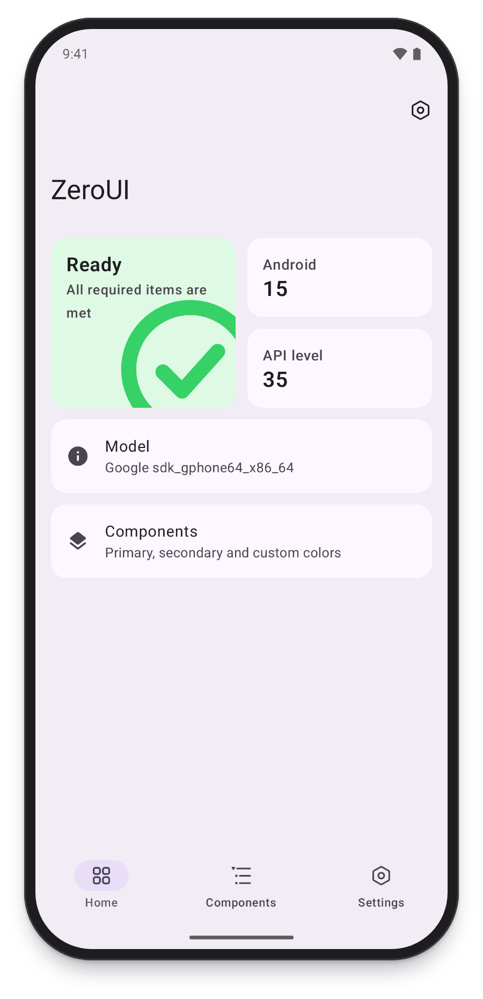
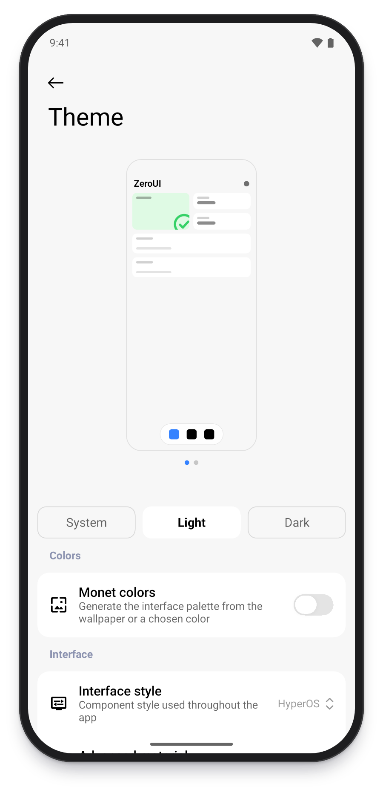
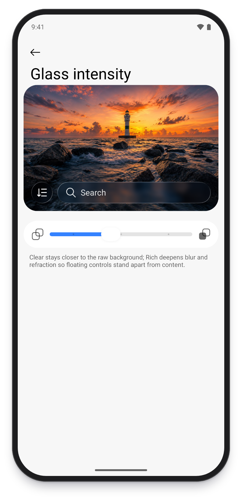
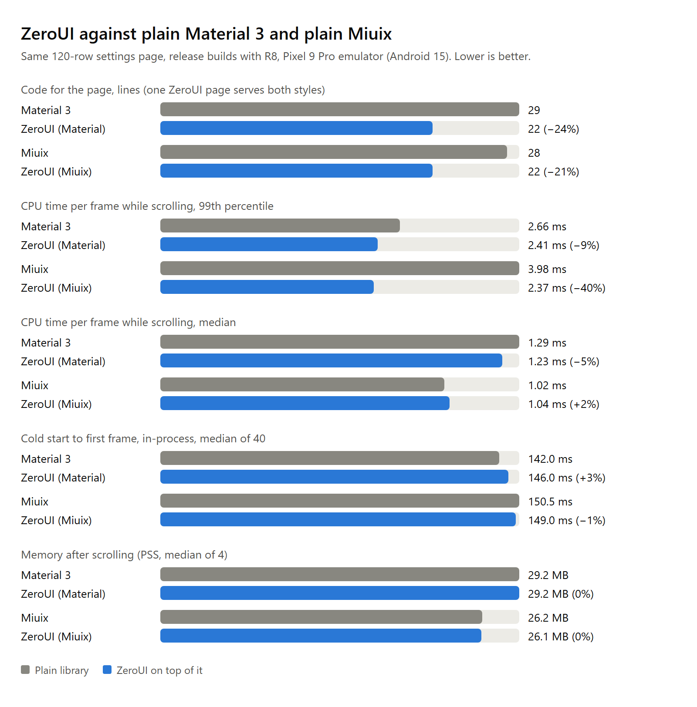
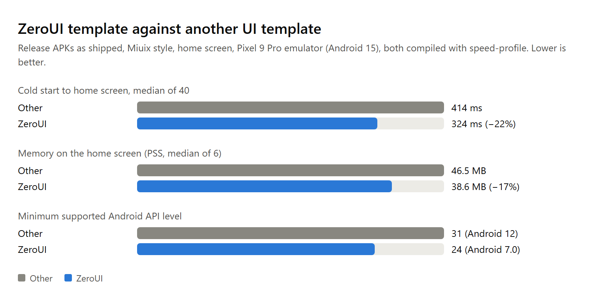

# ZeroUI

[English](README.md) | 简体中文

ZeroUI 是一套 Jetpack Compose 应用模板：一份页面代码，可切换 Miuix 与 Material 3 两种界面风格。

## 截图

<p align="center">
  
  
  
</p>
<p align="center"><sub>起始页 · Miuix 风格与 Liquid Glass 底栏 · 深色</sub></p>

<p align="center">
  
  
  
</p>
<p align="center"><sub>Material 3 风格 · 主题设置 · 玻璃强度</sub></p>

## 内容

- `:kit`：可复用的设计系统，包含主题、组件、导航、动效和液态玻璃。
- `:app`：模板应用，包含起始页、主页、组件示例、功能设置、应用设置、主题设置和关于页。
- `:baselineprofile`：生成 Baseline Profile 并测量冷启动与帧时间。

## 功能

- 主页：状态卡片、可拖动排序的卡片、下拉刷新，右上角进入应用设置。
- 主题：深浅色切换、动态配色、自定义主题色、纯黑模式。
- 界面：图标风格、界面缩放、列表密度、平滑圆角、顶栏样式、弹窗位置、页面背景图。
- 导航：贴底、悬浮、Liquid Glass 底栏，宽屏侧边栏，底栏顺序与显隐。
- 动效与手势：减弱动效、页面切换动画、预测性返回、触感反馈、屏幕刷新率。
- 外观管理：分享码、套用分享码、恢复默认。
- 其他：多语言、崩溃日志、GitHub Releases 更新检查、隐藏桌面图标、开源许可列表。
- 转屏和进程重建后恢复页面。
- 语言：英语、简体中文和俄语。

## 性能

同一个 120 行设置页，分别用原生库和 ZeroUI 实现，release 构建，在 Pixel 9 Pro 模拟器（Android 15）上测量。ZeroUI 一份页面代码同时支持两种风格，运行开销与直接使用原生库持平。



模板应用与另一款同类 UI 模板（图中记为 Other）发布包的对比，均为 Miuix 风格主页：



同时打包两种风格时，release APK 比只使用单一原生库的同一页面大约 0.2 MB；用 `-Pzeroui.style` 固定单一风格可以减小体积。模拟器数据只用于相对比较。

## 环境

- JDK 21
- Android SDK 37
- Android 7.0（API 24）及以上；部分视觉效果需要 Android 13

## 常用命令

```bash
./gradlew :app:assembleDebug
./gradlew testDebugUnitTest lintDebug
bash tools/ci.sh
```

`tools/ci.sh` 依次运行全部门禁，CI 使用同一个脚本：

| 步骤 | 内容 |
| --- | --- |
| 单元测试与 lint | `testDebugUnitTest`、`lintDebug`、`assembleDebug` |
| 令牌越界 | `node tools/check/tokens.cjs check` |
| 公开 API | `node tools/api/api.cjs check` |
| 包体上限 | `node tools/size/check.cjs`，上限在 `tools/size/limits.json` |

公开 API 或令牌基线有意变更时，分别运行 `node tools/api/api.cjs dump` 和 `node tools/check/tokens.cjs update`。

## 固定界面风格

```bash
./gradlew assembleRelease -Pzeroui.style=miuix
./gradlew assembleRelease -Pzeroui.style=material
```

不传参数时两种风格都保留，可在主题设置中切换。

## 测量

`tools/size/dex-methods.cjs` 统计 APK 的方法引用数。

## Baseline Profile

配置文件位于 `app/src/release/generated/baselineProfiles/baseline-prof.txt`，随 release 构建打包。界面或依赖有较大变更后，连接一台 API 33 及以上的模拟器或已 root 的设备重新生成：

```bash
./gradlew :app:generateReleaseBaselineProfile
```

对比有无配置文件的冷启动与帧时间（模拟器需追加 `-Pandroid.testInstrumentationRunnerArguments.androidx.benchmark.suppressErrors=EMULATOR`）：

```bash
./gradlew :baselineprofile:connectedBenchmarkReleaseAndroidTest
```

## 基于模板创建应用

1. 修改 `settings.gradle.kts` 中的 `rootProject.name`。
2. 修改 `app/build.gradle.kts` 中的 `namespace`、`applicationId` 和版本号，并同步重命名 `com.zeroui.template` 包。
3. 替换 `app_name`、`ic_logo` 和 `ic_launcher_*`。
4. 替换起始页协议文案，并实现自己的 `SetupChecks`。
5. 修改 `AppSettingsScreen.kt` 中的 `AppRepository`。
6. 在 `feature/tools` 添加功能设置，按 [架构说明](docs/ARCHITECTURE.zh-CN.md) 添加功能页。

## 采用 ZeroUI 的项目

- [CZero](https://github.com/Xocio/CZero)

## 致谢

- [KernelSU](https://github.com/tiann/KernelSU)：ZeroUI 的界面架构高度参考了其管理器的 Miuix 与 Material 双风格实现。
- [Miuix](https://github.com/compose-miuix-ui/miuix)：Miuix 风格的 Compose 组件。
- [Jetpack Compose](https://developer.android.com/compose) 与 [Material Design](https://m3.material.io/)。

## 文档

- [架构说明](docs/ARCHITECTURE.zh-CN.md)
- [兼容矩阵](docs/compat-matrix.zh-CN.md)
- [许可证](LICENSE)：Apache-2.0
- [第三方声明](THIRD_PARTY_NOTICES.md)
