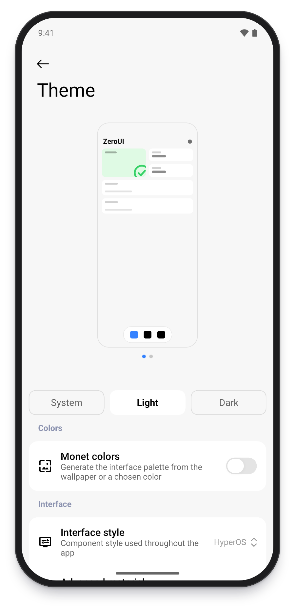

# Architecture

English | [简体中文](ARCHITECTURE.zh-CN.md)

## Modules

```text
:app  ──▶  :kit  ──▶  Miuix / Material 3 / Compose
```

Shared components go in `:kit`. Components that belong to one feature go in that feature's package in `:app`.

## `:kit` packages

| Package | Contents |
| --- | --- |
| `theme` | `ZeroTheme`, `ThemeSettings`, semantic colors and typography |
| `components` | Text, buttons, cards, list rows, inputs, windows, pages, icons and drag reordering |
| `navigation` | `ZeroNavHost`, `page`, `pushUnique`, `DeferUntilSettled` |
| `motion` | Transitions and reduced motion |
| `glass` | Blur, Liquid Glass controls and page backgrounds |
| `effect` | Flowing background and ripple shaders |

## `:app` packages

| Package | Contents |
| --- | --- |
| `core` | `AppContainer` and `appViewModel` |
| `data` | Settings model and storage, share codes, background image, update check, language and logs |
| `navigation` | `AppRoute` |
| `feature/welcome` | Welcome flow |
| `feature/main` | Main frame and bottom bar |
| `feature/home` | Home page and its thumbnail preview |
| `feature/gallery` | Component gallery |
| `feature/tools` | Sample feature settings |
| `feature/settings` | App settings, theme settings, bottom bar settings, background settings and the about page |
| `feature/update` | Update dialog |

## Theme

`ZeroTheme` takes one `ThemeSettings` and hands down colors, typography, scale, motion and appearance options.



## Components

Components dispatch on the active style inside `:kit`:

- `Card`: a card. The caller sets the inner padding.
- `ListCard` / `ListSection`: groups of settings rows.
- `CardSlice`: a grouped row for lazy lists.
- `ButtonVariant.Primary` / `Secondary`: button emphasis.
- `ZeroPage` / `ZeroPageFrame`: the standard page with a collapsing top bar and blur.

## Pages and state

- Pages that load data use a `ViewModel` and an immutable `UiState`. See `HomeViewModel`.
- Dependencies are created in `AppContainer`. Pages get their ViewModel through `appViewModel { ... }`.
- UI state such as typed text or dialog visibility uses `rememberSaveable`.
- Flows that need confirmation can use `ConfirmDialogState.confirm()`.

## Navigation

Routes are declared in `AppRoute` and need `@Serializable`:

```kotlin
@Serializable
data class Components(val section: GallerySection) : AppRoute
```

Register the page in `AppNavGraph` in `AppRoot.kt` and navigate with `controller.pushUnique(route)`.

Heavy content can be wrapped in `DeferUntilSettled`, which composes it after the enter transition ends.

## Settings

`SettingsRepository` stores `AppSettings`. Settings pages read and write through `LocalAppController`. To add a setting:

1. Add a field to `AppSettings` or `AppearanceExtras`.
2. If it affects the theme, pass it to `ThemeSettings` in `toThemeSettings`.
3. Add the row to a settings page.

## Welcome flow

- `WelcomeViewModel` runs the checks and tracks completion.
- `SetupChecks` defines the app's own check items.
- `WelcomeScreen` handles paging, permission requests and page composition.
- `WelcomeFx` holds the hero visual and the page motion.

`SetupItemId.required` decides whether an item blocks the next step.

## Tests

| Test | Covers |
| --- | --- |
| `SettingsCodecTest` | Settings encoding and decoding, tolerance of bad input, reset to defaults |
| `SettingsRepositoryTest` | State publishing and persistence |
| `AppRouteTest` | Route serialization and de-duplication |
| `WelcomeViewModelTest` | Check flow and reachable pages |
| `StringResourcesTest` | Keys and placeholders across the three languages |
| `SlicePositionTest` | Grouped row positions |
