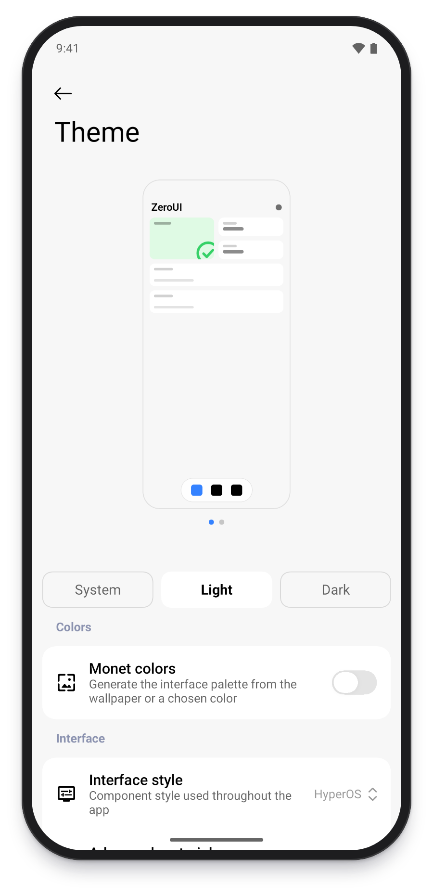

# 架构说明

[English](ARCHITECTURE.md) | 简体中文

## 模块

```text
:app  ──▶  :kit  ──▶  Miuix / Material 3 / Compose
```

通用组件放在 `:kit`，功能专属组件放在 `:app` 对应的 `feature` 包。

## `:kit` 目录

| 包 | 内容 |
| --- | --- |
| `theme` | `ZeroTheme`、`ThemeSettings`、语义颜色和字体 |
| `components` | 文本、按钮、卡片、列表行、输入、窗口、页面、图标和拖动排序 |
| `navigation` | `ZeroNavHost`、`page`、`pushUnique`、`DeferUntilSettled` |
| `motion` | 转场与动效减弱 |
| `glass` | 模糊、液态玻璃控件和页面背景 |
| `effect` | 流动背景和涟漪着色器 |

## `:app` 目录

| 包 | 内容 |
| --- | --- |
| `core` | `AppContainer` 与 `appViewModel` |
| `data` | 设置模型与存储、分享码、背景图、更新检查、语言和日志 |
| `navigation` | `AppRoute` |
| `feature/welcome` | 起始页 |
| `feature/main` | 主框架和底栏 |
| `feature/home` | 主页和缩略预览 |
| `feature/gallery` | 组件示例 |
| `feature/tools` | 功能设置示例 |
| `feature/settings` | 应用设置、主题设置、底栏设置、背景设置和关于页 |
| `feature/update` | 更新弹窗 |

## 主题

`ZeroTheme` 接收一个 `ThemeSettings`，并下发颜色、字体、缩放、动效和外观选项。



## 组件

组件在 `:kit` 内部按当前风格分发：

- `Card`：卡片，内边距由调用方指定。
- `ListCard` / `ListSection`：设置行分组。
- `CardSlice`：懒加载列表中的分组行。
- `ButtonVariant.Primary` / `Secondary`：按钮层级。
- `ZeroPage` / `ZeroPageFrame`：带折叠顶栏和模糊效果的标准页面。

## 页面与状态

- 需要加载数据的页面使用 `ViewModel` 和不可变 `UiState`，示例见 `HomeViewModel`。
- 依赖在 `AppContainer` 中创建，页面通过 `appViewModel { ... }` 获取 ViewModel。
- 输入内容、弹窗显隐等界面状态使用 `rememberSaveable`。
- 需要确认的流程可以使用 `ConfirmDialogState.confirm()`。

## 导航

路由定义在 `AppRoute`，需要标注 `@Serializable`：

```kotlin
@Serializable
data class Components(val section: GallerySection) : AppRoute
```

在 `AppRoot.kt` 的 `AppNavGraph` 注册页面，使用 `controller.pushUnique(route)` 跳转。

重内容可用 `DeferUntilSettled` 包裹，在进入转场结束后组合。

## 设置

`SettingsRepository` 保存 `AppSettings`，设置页通过 `LocalAppController` 读写。新增设置项的步骤：

1. 在 `AppSettings` 或 `AppearanceExtras` 增加字段。
2. 需要作用于主题时，在 `toThemeSettings` 中传给 `ThemeSettings`。
3. 在设置页添加对应的行。

## 起始页

- `WelcomeViewModel` 负责检测流程和完成状态。
- `SetupChecks` 定义应用自己的检测项。
- `WelcomeScreen` 负责翻页、权限请求和页面组合。
- `WelcomeFx` 负责主视觉和页面动效。

`SetupItemId.required` 决定某一项是否阻止进入下一步。

## 测试

| 测试 | 覆盖内容 |
| --- | --- |
| `SettingsCodecTest` | 设置编解码、容错和恢复默认 |
| `SettingsRepositoryTest` | 状态发布与持久化 |
| `AppRouteTest` | 路由序列化与去重 |
| `WelcomeViewModelTest` | 检测流程与翻页范围 |
| `StringResourcesTest` | 三种语言的 key 与占位符 |
| `SlicePositionTest` | 分组行位置 |
