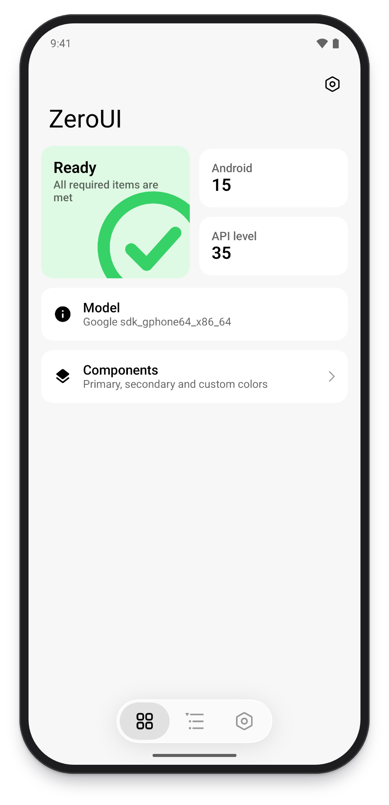

# Compatibility matrix

English | [简体中文](compat-matrix.zh-CN.md)

`minSdk` is 24 (Android 7.0). The table lists the features that depend on the system version and what happens below the threshold.

## System version thresholds

| Feature | Minimum API | Below the threshold |
| --- | --- | --- |
| Progressive top bar blur ("Top bar blur" in theme settings, off by default), frosted cards, blurred page background | 33, and the device supports runtime shaders | The top bar uses an opaque surface color and cards are translucent or solid, with no blur pipeline. The "Top bar blur" switch is hidden |
| Flowing background (`BgEffectBackground`) | 33, and the device supports runtime shaders | Only the content is drawn, without the background effect |
| Smooth corners (squircle) | 33, and the device supports runtime shaders | Ordinary rounded corners |
| Liquid Glass bottom bar, cards, slider and switch | 33 | The bar and cards use the regular style. Liquid can still be picked under advanced materials but does nothing, and the glass intensity entry is hidden |
| Liquid ripple (`LiquidRipple`) | 33 | No ripple |
| Welcome flow blur transition (`RenderEffect`) | 31 | No blur. The rest of the animation is unchanged |
| Notification permission request | 33 | Not requested, treated as granted |
| Monet colors (from the system wallpaper) | 31 | The seed color picked on the theme page, or the baseline color |
| System accent color in the palette preview | 31 | A neutral color |
| App-level light and dark sync (`setApplicationNightMode`) | 31 | Not synced. Only the app's own UI is affected |
| Image decoding (`ImageDecoder`) | 28 | `BitmapFactory` with a sample size |
| Reading the display mode (`Context.display`) | 30 | `defaultDisplay` |
| Frame rate power savings balance (`setFrameRatePowerSavingsBalanced`) | 35 | Not called. The refresh rate still follows the display mode preference |
| Color spec 2025 | 36 | The 2021 spec |

The Liquid Glass bottom bar on API 33 and above:

## Predictive back

`AndroidManifest.xml` declares `enableOnBackInvokedCallback="true"`. There are three modes:

| Mode | Behavior |
| --- | --- |
| Off | `BackHandler` pops straight to the previous page |
| Official | `NavDisplay` handles the system predictive back |
| Custom | The back gesture follows the finger |

How each mode behaves on API 33 and below has not been verified.

## Linked settings

- With the Material style, the advanced material and glass intensity options are hidden.
- With Liquid as the advanced material on a device below API 33, the home background card material does not offer Liquid.
- Building with `-Pzeroui.style=miuix` or `material` fixes the style, and the settings page no longer shows the UI style option.

## Verification status

| Item | Status |
| --- | --- |
| Every flow on an API 35 emulator (Pixel 9 Pro) | Verified |
| Gated branches on API 33 and above | Checked against the code, not verified one by one on a device |
| Fallback branches on API 32 and below | Not verified (no matching system image on this machine) |
| Frame time on low-end GPUs | Not verified |
